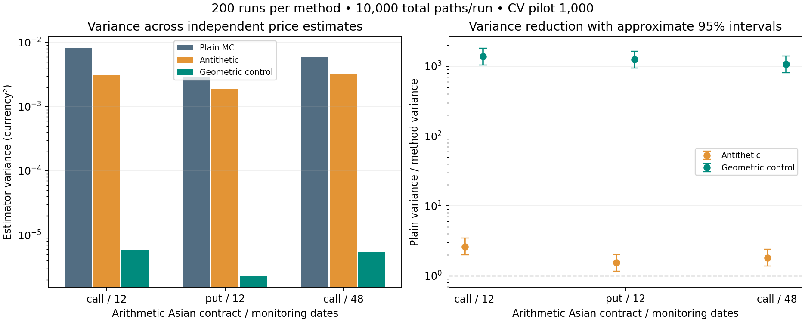
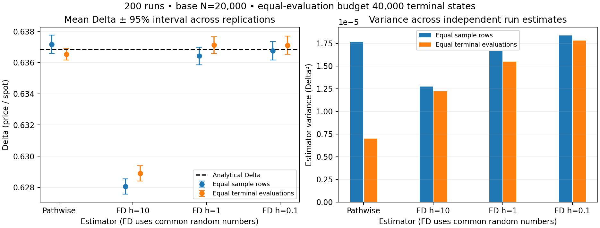

# Monte Carlo Pricing & Greeks Engine


<p align="center">
  
</p>

A modular quantitative finance framework for pricing vanilla and exotic derivatives using Monte Carlo simulation, variance reduction techniques, numerical Greeks estimation, and stochastic volatility models.

---

# Overview

This project implements a quantitative derivatives pricing framework from scratch in Python.

The objective is not only to compute derivative prices, but to study the numerical behaviour of pricing methods through:

- stochastic modelling;
- Monte Carlo estimation;
- variance reduction;
- Greeks computation;
- convergence analysis;
- empirical validation.

The framework is designed as a small quantitative research library rather than a collection of standalone notebooks.

The main workflow is:

```
Stochastic Model
        |
        v
Simulation Engine
        |
        v
Derivative Product
        |
        v
Monte Carlo Pricing
        |
        v
Statistics & Risk Analysis
```

---

# Research Highlights

- Verified Monte Carlo convergence with empirical standard error scaling consistent with the theoretical \(N^{-1/2}\) behaviour.
- Reduced Asian option estimator variance by approximately **99.83%** using geometric control variates.
- Benchmarked Delta estimation using finite differences, pathwise differentiation and likelihood ratio methods.
- Analysed discretisation effects in Heston stochastic volatility simulations.
- Built a modular pricing architecture separating models, products, simulation and numerical diagnostics.

---

# Key Features

| Component | Implementation |
|---|---|
| Market models | Black-Scholes and Heston |
| European options | Analytical and Monte Carlo pricing |
| Digital options | Likelihood ratio validation experiments |
| Asian options | Arithmetic path-dependent pricing |
| Barrier options | Discrete monitoring Monte Carlo |
| Variance reduction | Antithetic variables and control variates |
| Greeks | Finite differences, pathwise and likelihood ratio |
| Numerical validation | Convergence studies and repeated experiments |

---

# Architecture

The project follows a modular quantitative software design.

```
                 Models
                   |
                   v
              Simulation
                   |
                   v
               Products
                   |
                   v
                Pricing
                   |
                   v
             Statistics & Greeks
```

The core implementation is contained in:

```
src/mc_pricer/
```

The separation of responsibilities is:

| Module | Responsibility |
|---|---|
| `models/` | Define stochastic dynamics |
| `products/` | Define derivative payoff functions |
| `simulation/` | Generate Monte Carlo scenarios |
| `pricing/` | Compute discounted expectations |
| `variance_reduction/` | Reduce estimator variance |
| `greeks/` | Estimate risk sensitivities |
| `statistics/` | Analyse numerical uncertainty |

---

# Mathematical Framework

Derivative prices are computed under the risk-neutral measure:

\[
V_0=e^{-rT}\mathbb{E}^{\mathbb Q}[\Phi(S)]
\]

Monte Carlo estimation:

\[
\hat V_N=
e^{-rT}
\frac{1}{N}
\sum_{i=1}^{N}\Phi(S_i)
\]

Numerical methods are validated through:

- analytical Black-Scholes benchmarks;
- convergence studies;
- confidence intervals;
- repeated independent experiments.

Detailed mathematical documentation:

```
docs/mathematical_background.md
```

---

# Models

## Black-Scholes

Location:

```
src/mc_pricer/models/black_scholes.py
```

Capabilities:

- exact geometric Brownian motion simulation;
- terminal price generation;
- path simulation;
- analytical pricing benchmarks;
- Greeks validation.

---

## Heston Stochastic Volatility

Location:

```
src/mc_pricer/models/heston.py
```

Implemented features:

- stochastic volatility dynamics;
- correlated Brownian motions;
- Full Truncation Euler discretisation;
- time-step convergence analysis.

Parameters:

- kappa;
- theta;
- xi;
- rho;
- v0.

---

# Derivative Products

Implemented contracts are located in:

```
src/mc_pricer/products/
```

## European Options

```
european.py
```

Supports:

- European calls;
- European puts.

## Asian Options

```
asian.py
```

Features:

- arithmetic averaging;
- path simulation;
- monitoring-frequency analysis.

## Barrier Options

```
barrier.py
```

Features:

- up-and-out barrier options;
- discrete monitoring;
- discretisation bias analysis.

---

# Variance Reduction

## Antithetic Variables

Implementation:

```
src/mc_pricer/variance_reduction/antithetic.py
```

Uses paired simulations:

\[
Z,-Z
\]

to reduce estimator variance.

---

## Control Variates

Implementation:

```
src/mc_pricer/variance_reduction/control_variates.py
```

Example:

Arithmetic Asian option controlled using the geometric Asian payoff.

---

# Greeks Estimation

Implemented methods:

```
src/mc_pricer/greeks/
```

## Finite Differences

Includes:

- Delta;
- Gamma;
- Vega.

Uses common random numbers to reduce numerical noise.

## Pathwise Greeks

Direct differentiation of simulated paths.

Implemented:

- European Delta.

## Likelihood Ratio Method

Density-based sensitivity estimation.

Useful for:

- discontinuous payoffs;
- digital options.

---

# Selected Numerical Results

| Experiment | Result |
|---|---|
| Monte Carlo convergence | Standard error follows \(N^{-1/2}\) scaling |
| Asian control variate | Approximately 99.83% variance reduction |
| Greeks comparison | FD, pathwise and likelihood ratio benchmarking |
| Heston analysis | Time discretisation convergence study |

---

## Monte Carlo Convergence

<p align="center">
  
</p>

The empirical convergence rate is compared with the theoretical Monte Carlo standard error behaviour.

---

## Variance Reduction

<p align="center">
  
</p>

The geometric Asian control variate significantly reduces estimator variance in the benchmark experiment.

---

## Greeks Comparison

<p align="center">
  
</p>

Delta estimation methods are compared against analytical benchmarks.

---

## Heston Convergence

<p align="center">
  
</p>

The stochastic volatility extension analyses the effect of time discretisation.

---

# Installation

Clone the repository:

```bash
git clone https://github.com/matteomatraxia26/monte-carlo-pricing-engine.git

cd monte-carlo-pricing-engine
```

Create an environment:

```bash
python -m venv .venv

source .venv/bin/activate
```

Install dependencies:

```bash
pip install -r requirements.txt
pip install -e .
```

---

# Quick Start

Example: price a European call option.

```python
from mc_pricer.models.black_scholes import BlackScholesModel
from mc_pricer.products.european import EuropeanOption
from mc_pricer.pricing.monte_carlo import price_monte_carlo
from mc_pricer.simulation.random import make_rng

model = BlackScholesModel(
    spot=100.0,
    rate=0.05,
    volatility=0.20,
)

option = EuropeanOption(
    strike=100.0,
    option_type="call",
)

result = price_monte_carlo(
    model=model,
    product=option,
    maturity=1.0,
    n_paths=100000,
    rng=make_rng(42),
)

print(result.price)
print(result.confidence_interval)
```

---

# Experiments

All numerical experiments are located in:

```
experiments/
```

| Script | Purpose |
|---|---|
| `european_validation.py` | Monte Carlo vs Black-Scholes |
| `mc_convergence.py` | Error convergence analysis |
| `variance_reduction.py` | Estimator comparison |
| `greeks_comparison.py` | Greeks benchmarking |
| `exotic_pricing.py` | Asian and barrier pricing |
| `heston_analysis.py` | Stochastic volatility analysis |

Generated outputs:

```
results/
├── figures/
└── tables/
```

---

# Testing

The project includes tests covering:

- pricing functions;
- payoff definitions;
- simulation engines;
- variance reduction;
- Greeks estimators;
- Heston components.

Run:

```bash
pytest
```

---

# Documentation

Detailed documentation:

```
docs/

mathematical_background.md
methodology.md
results.md
roadmap.md
```

---

# Future Extensions

Possible developments:

- quasi-Monte Carlo methods;
- automatic differentiation Greeks;
- market calibration interface;
- GPU acceleration;
- additional stochastic volatility schemes.

---

# License

MIT License
