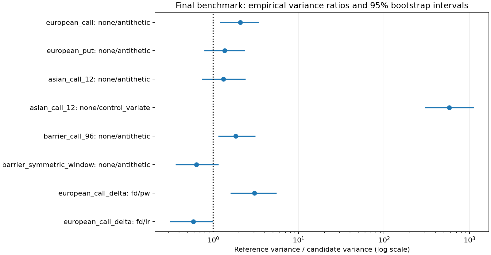

# Monte Carlo Pricing & Greeks Engine

A Python quantitative research library for vanilla and path-dependent option
pricing, variance reduction and sensitivity estimation. Numerical methods are
implemented directly with NumPy/SciPy and validated through independent formulas,
automated tests and repeated experiments.

**Research release v0.17.0 — all 17 development milestones completed.**

## Overview

The project follows a single question: how can a Monte Carlo price or Greek be
made both accurate and statistically defensible? It separates sampling error,
finite-difference bias, time integration, contractual monitoring and model error.
Start with the [research report](docs/results.md) or the
[executed overview notebook](notebooks/project_overview.ipynb).

## Features

- Exact Black–Scholes grid simulation and full-truncation Heston simulation.
- European, digital, Asian and discrete up-and-out payoffs.
- Correct uncertainty for IID payoffs, antithetic pairs and independent-pilot controls.
- Finite-difference Greeks with common random numbers; pathwise and likelihood-ratio Delta.
- Reproducible convergence, variance, coverage, rare-event and integration studies.
- 224 automated test functions; raw results, stream keys, figures and provenance metadata.

## Project architecture

| Location | Responsibility |
|---|---|
| `src/mc_pricer/models/` | Validated immutable model parameters |
| `src/mc_pricer/products/` | Pure payoff definitions |
| `src/mc_pricer/simulation/` | Gaussian streams, exact GBM and recursive Heston paths |
| `src/mc_pricer/pricing/` | Analytical references and Monte Carlo estimators |
| `src/mc_pricer/variance_reduction/` | Antithetic pairs and pilot-fitted controls |
| `src/mc_pricer/greeks/`, `statistics/` | Sensitivities, intervals and diagnostics |
| `experiments/`, `tests/` | Reproducible studies and verification |
| `results/`, `docs/`, `notebooks/` | Evidence, derivations and presentation |

Notebook cells call the library and inspect saved experiments. No essential
pricing implementation lives in a notebook. See [the completed roadmap](docs/roadmap.md).

## Mathematical framework

For a non-dividend-paying stock and a selected risk-neutral model:

$$V_0=e^{-rT}\mathbb E^{\mathbb Q}[\Phi(S)],\qquad
\widehat V_N=\frac1N\sum_{i=1}^N e^{-rT}\Phi_i.$$

For independent discounted samples, SE=s/sqrt(N), with sample variance denominator
N-1. Normal confidence intervals quantify sampling uncertainty, not model or
numerical bias. Antithetics and controls require their own independent-unit counts.
[Derivations](docs/mathematical_background.md) cover simulation, variance reduction,
Greeks and the Heston Fourier reference.

## Supported models

**Black–Scholes (CORE):** exact lognormal transitions with constant rate and volatility.
**Heston (ADVANCED):** auxiliary-state full truncation with an exponential stock
step using old effective variance; separate integration and monitoring grids.
A deterministic Fourier European reference validates integration error.

Maturity is in years; rates are continuously compounded; volatility is decimal.
Heston v0/theta are variances. Negative rates are supported. All models omit dividends.

## Supported products

European calls/puts, cash-or-nothing calls/puts, arithmetic/geometric Asian calls/puts,
and zero-rebate up-and-out calls. Asians average jT/m, j=1,...,m, excluding inception.
Barriers include inception and knock out on equality. Monitoring is discrete.

## Variance reduction

Under Black–Scholes, antithetics use Z and -Z and calculate uncertainty from
independent pair means. Arithmetic Asians use the exact geometric-Asian expectation
and beta fitted on an independent pilot. The path budget includes the pilot.
Controls evaluate two payoffs per path. Antithetics need not improve a barrier.
Heston pricing currently uses plain IID sampling.

## Greeks estimation

Black–Scholes Delta/Gamma/Vega use central differences with common random numbers.
European vanilla Delta also supports pathwise differentiation; vanilla/digital
spot Delta supports likelihood ratios. Vega is per unit absolute volatility.
Pathwise Gamma, LR Gamma/Vega and Heston Greeks are future extensions.

## Numerical experiments

The [evidence index](results/tables/final_evidence_index.csv) maps all 12 required
figures to numerical sources and reproduction commands. Independent-run studies
report empirical bias, variance, RMSE and interval coverage where exact targets
are known. Unknown arithmetic-Asian and multi-date barrier bias/RMSE remain missing.

## Selected results

| Evidence | Measurement | Scope |
|---|---|---|
| MC standard-error convergence | Call -0.49985; put -0.50032 | 200 runs/N, 10 sample counts; fitted log-log exponents |
| Geometric control for Asian call | 99.83% lower empirical variance | M16: 50 runs, 12,000 paths including 1,200 pilot paths |
| FD/pathwise Delta variance ratio | 3.05; bootstrap interval [1.60,5.51] | M16: equal 12,000 terminal evaluations, FD h=1 |
| Heston high-xi call error | .43256 at 12 steps; .01062 at 384 | M15: pooled SE .02956/.02732; fixed model/contract |

The Asian variance ratio is 578.4 [300.1,1123.2], not a universal factor or
speedup: the control costs more per run. Heston residual bias at 384 steps is
unresolved. Earlier studies retain their own budgets and intervals. The report
also retains failures: antithetic counterexamples, zero-SE rare-event estimates
and a likelihood-ratio repeated-mean interval that misses its target.



## Installation

From the repository root with Python 3.11+:

```bash
python3 -m venv .venv
source .venv/bin/activate
python -m pip install -r requirements.txt
```

Core dependencies: NumPy and SciPy. Research uses pandas/matplotlib; tests use
pytest. No specialized finance library is required. The optional notebook can
be opened in a Jupyter-compatible editor; the supplied Python execution checker
needs only the research dependencies.

## Usage

```python
from mc_pricer import (
    BlackScholesModel, EuropeanOption, ArithmeticAsianOption,
    black_scholes_price, price_monte_carlo, pathwise_delta, make_rng,
)
model = BlackScholesModel(spot=100.0, rate=0.05, volatility=0.20)
call = EuropeanOption(strike=100.0)
quote = price_monte_carlo(model, call, 1.0, 100_000, rng=make_rng(17))
print(quote.price, quote.standard_error, quote.confidence_interval)
print("Analytical:", black_scholes_price(model, 100.0, 1.0))

asian = price_monte_carlo(
    model, ArithmeticAsianOption(100.0), 1.0, 12_000, n_steps=12,
    variance_reduction="control_variate", n_pilot_paths=1_200, rng=make_rng(18),
)
delta = pathwise_delta(model, call, 1.0, 12_000, rng=make_rng(19))
print("Asian:", asian.price, "Delta:", delta.estimate)
```

A complete small demonstration is `python examples/portfolio_demo.py`.

## Testing

```bash
python -m pytest
```

The delivered environment lacked pytest. All 224 plain pytest-discoverable test
functions passed via `unittest.FunctionTestCase`; this is not a claim of pytest
execution. Reproduce that fallback and the presentation check with:

```bash
PYTHONPATH=src python tests/run_standard_library.py --report-name milestone_17_tests.json
python -m experiments.check_presentation
```

The presentation checker executes notebook code cells sequentially with Python,
saves real outputs and checks README examples. It is not a Jupyter-kernel test.
Release verification records are in `results/raw/milestone_17_*.json`.

## Reproducibility

```bash
python -m experiments.final_experiments
python -m experiments.final_experiments --rebuild
```

The first command runs the M16 800-estimate comparison and indexes historical
studies. The second checks raw/source hashes and reconstructs outputs without
resimulation. Prior full studies have separate commands in the evidence index.
Seeds, stream keys, draw order and package versions determine numerical replay;
runtimes vary. Dependency ranges are not a lockfile. See [methodology](docs/methodology.md).

## Future extensions

Implemented CORE and selected ADVANCED components are complete for this scope.
Possible additions: Heston Greeks/controls, batching, continuous-barrier corrections,
lookbacks, Sobol/QMC, alternative Heston schemes and optional Numba/parallelism.
The current release is a research library, not a production risk-system certification.

## Connection with Heston calibration project

```python
from pathlib import Path
from mc_pricer import HestonModel, price_heston_monte_carlo
heston = HestonModel.from_json(
    Path("examples/heston_calibration.json").read_text(), spot=100.0, rate=0.05,
)
heston_quote = price_heston_monte_carlo(
    heston, ArithmeticAsianOption(100.0), 1.0, 12_000, 384,
    n_observations=12, rng=make_rng(20),
)
print(heston_quote.price, heston_quote.standard_error)
```

The dictionary/JSON interface accepts risk-neutral kappa,theta,xi,rho,v0.
The included payload is illustrative; neural-network training, market calibration
and conversion of physical parameters to Q are outside this repository.

For a technical discussion: [interview questions](docs/interview_questions.md),
[12-minute walkthrough](docs/interview_walkthrough.md), [CV bullets](docs/cv_targets.md).
