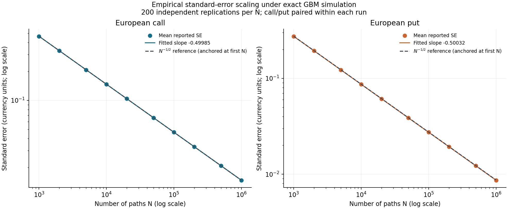
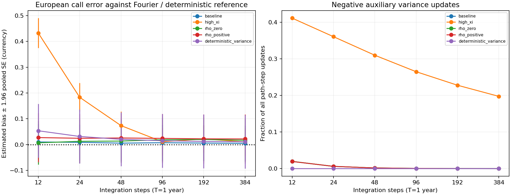

# Monte Carlo pricing and Greeks: research report

Research release v0.17.0. This report selects evidence from the completed studies;
[the research log](research_log.md) preserves the full milestone-by-milestone record.
Tables, raw observations and reproduction commands remain in the repository.

## 1. Introduction

The objective is a transparent Python pricing library with defensible numerical
uncertainty. European options supply independent analytical checks; Asians and
barriers introduce monitoring-dependent payoffs; Heston introduces numerical
integration of stochastic variance. The contribution is implementation and
empirical validation, not a new pricing formula or a market-performance claim.

## 2. Methodology

Prices are discounted risk-neutral payoff means. Exact GBM transitions eliminate
time-stepping error at specified grid dates. Independent sample variance gives
Monte Carlo SE; antithetics use pair means, controls production residuals, and
CRN differences coupled rows. A separate pilot estimates each control coefficient.

Comparisons use independent replications, explicit path/payoff budgets, empirical
variance and RMSE. Sample variance uses R-1 and RMSE uses R; consequently
RMSE² = empirical_bias² + (R-1)*sample_variance/R. Bias and exact-target coverage
are reported only where an independent reference is available. Confidence
intervals are pointwise and exclude model and numerical bias.

Full definitions and mathematical derivations are in
[methodology](methodology.md) and [mathematical background](mathematical_background.md).

## 3. Experimental setup

The usual baseline is S0=K=100,r=.05,sigma=.20,T=1. Heston uses
v0=theta=.04,kappa=2,xi=.3,rho=-.7, with explicit stressed variants.
Contracts omit dividends. Asian monitoring excludes inception; barrier monitoring
includes it, with equality knocking out. The baseline barrier is B=120.

Studies answer distinct questions and are not pooled indiscriminately:

| Study | Replications and budget | Main question |
|---|---|---|
| M5 | 200/N, ten N from 1,000 to 1,000,000 | SE/RMSE scaling and coverage |
| M9/M10 | 200/method; 10,000 paths | Antithetics and independent-pilot controls |
| M11/M12 | 100/200 per setting | Bump error, CRN and pathwise Delta |
| M13/M14 | Multiple stress cases; repeated estimates | Rare events and likelihood-ratio Delta |
| M15 | 30 x 4,000 paths per scenario/grid | Heston integration at fixed monitoring |
| M16 | 50/method; 800 estimates total | New-seed final comparison with explicit costs |

M16 price estimators use 12,000 paths, including 1,200 pilot paths for controls.
The control evaluates two payoffs per path. M16 Greeks use 12,000 terminal
valuations: 6,000 FD Delta/Vega rows, 4,000 Gamma rows, 12,000 PW/LR rows.
Timings measure estimator calls in the recorded environment and are not universal.

## 4. Black–Scholes validation

Analytical baseline call/put prices are 10.4505835722 and 5.5735260223. Validation
includes independent payoff quadrature, parity, no-arbitrage bounds, derivatives,
boundaries, RNG replay and moment checks. These give stronger evidence than
comparing two implementations of the same formula.

In M16 the mean plain call is 10.451119 (empirical bias .000535); the mean plain
put is 5.561222 (bias -.012304). Their empirical run RMSEs are .126902 and .065685.
A finite-run mean need not equal the target even for an unbiased estimator.

Sources: [analytical benchmark](../results/tables/analytical_benchmark.csv),
[European N sweep](../results/tables/european_validation.csv),
[final benchmark](../results/tables/final_benchmark.csv).

## 5. Monte Carlo convergence

The fitted log(mean reported SE) against log(N) slopes are -0.49985 for calls
and -0.50032 for puts, consistent with N^-1/2. A tenfold reduction in SE therefore
requires roughly one hundred times as many independent samples. Actual error
need not decrease monotonically as N increases.

At N=1,000,000, call/put price-interval coverage over 200 runs is 96.5%/96.0%;
Wilson intervals are [92.95%,98.29%]/[92.31%,97.96%]. These are estimates with
replication uncertainty, not proof of nominal coverage for every model/payoff.
The slopes are descriptive fits, not empirical proofs of a theorem.

Sources: [convergence table](../results/tables/mc_convergence.csv),
[slope table](../results/tables/mc_convergence_slopes.csv).

## 6. Variance reduction

M16 uses fresh independent streams and 50 replications per method. Ratios below
compare final-estimator variance at the stated cost, not individual payoff variance.

| Reference / candidate | Empirical ratio | Approx. 95% bootstrap interval |
|---|---:|---:|
| European call: plain / antithetic | 2.088 | [1.193,3.445] |
| Asian call, 12 dates: plain / antithetic | 1.321 | [.745,2.392] |
| Asian call, 12 dates: plain / geometric control | 578.437 | [300.138,1123.212] |
| Barrier, 96 dates: plain / antithetic | 1.847 | [1.150,3.118] |
| Symmetric terminal barrier: plain / antithetic | .640 | [.363,1.159] |

The geometric control reduces empirical variance by 99.83% in the final study.
It costs 4.663 ms per run versus 3.837 ms for plain Asian MC. More accuracy per
unit work does not imply a faster individual call. The descriptive variance-times-
runtime ratio is about 476; it is not a directly measured speedup.

M10 measured a larger ratio, 1,372.7 [1,038.9,1,813.9], using 200 runs, 10,000 paths
and a 1,000-path pilot. Different budgets and finite-study variability matter;
both records are retained. Neither establishes exact arithmetic-Asian bias/RMSE.

Antithetics are not universally beneficial. The symmetric barrier's M16 interval
includes one, but M9's independent moment quadrature gives population VRF .771985:
positive antithetic covariance increases variance. The 96-date barrier result is
also scenario-specific; the earlier M9 interval did not resolve a benefit.

Sources: [final comparisons](../results/tables/final_comparisons.csv),
[M10 controls](../results/tables/control_comparison.csv),
[barrier counterexample](../results/tables/antithetic_window_benchmark.csv).

## 7. Greeks estimation

Central differences estimate a finite-bump derivative. CRN preserves covariance
between bumped valuations; it does not remove truncation bias. Pathwise vanilla
Delta avoids a bump, while likelihood ratios differentiate the terminal density
and can handle digital payoffs. All implemented Greeks in this release are GBM Greeks.

M16 results at equal 12,000 terminal valuations:

| Method / Greek | Mean estimate | Analytical value | Empirical run RMSE |
|---|---:|---:|---:|
| FD Delta, h=1 | .636611 | .636831 | .008437 |
| Pathwise Delta | .636853 | .636831 | .004831 |
| LR Delta | .640283 | .636831 | .011546 |
| FD Gamma, h=1 | .018892 | .018762 | .001621 |
| FD Vega, h=.01 | 37.356527 | 37.524035 | .989065 |

The FD/pathwise Delta variance ratio is 3.049 [1.598,5.512]. That result depends
on the budget: equal independent row counts would be a different comparison.
Vega units are price per 1.00 volatility, not per percentage point.

An unfavorable result is retained: LR Delta's repeated mean is 2.193 empirical
SEs above its target, so its pointwise mean interval misses. This alone does not
prove bias; simultaneous coverage is not claimed. M14 independently validated
LR moments and shows that the relative efficiency reverses for a digital:
LR/FD h=1 variance ratio is .03887 [.02946,.05168] at equal 20,000 terminal evaluations.

Sources: [final benchmark](../results/tables/final_benchmark.csv),
[bump study](../results/tables/fd_greek_bumps.csv),
[LR comparison](../results/tables/lr_comparisons.csv).

## 8. Exotic options

Arithmetic Asians are validated through exact average moments, parity, geometric
bounds and paired monitoring studies. An exact geometric control expectation
does not turn the arithmetic option into an analytically priced product.

Under GBM, the 12-date Asian call is 6.152728 ± .026867 SE in M7. The M8 up-and-out
call is 1.842930 ± .010602 SE with 12 future checks and 1.299871 ± .008650 SE with
384. Added barrier checks weakly decrease each coupled payoff; the difference
is contractual monitoring sensitivity, not GBM integration error. Neither grid
is an exact continuous-barrier contract.

Sources: [Asian monitoring](../results/tables/asian_monitoring.csv),
[barrier monitoring](../results/tables/barrier_monitoring.csv).

## 9. Heston extension

Full truncation carries a raw auxiliary variance and uses its positive part in
the coefficients. An exponential stock step uses old variance. The CIR process
is nonnegative even when the Feller condition fails; negative Euler auxiliary
states are a numerical feature, not negative physical variance.

Five scenarios and six coupled integration grids retain 12 contractual exotic
observations. European references use affine Fourier inversion, independently
checked by Riccati ODE integration, parity, limits and cutoff sensitivity.

| High-xi scenario, xi=.9 | Mean call | Reference | Estimated error | Pooled SE |
|---|---:|---:|---:|---:|
| 12 steps | 9.964268 | 9.531708 | .432561 | .029563 |
| 384 steps | 9.542327 | 9.531708 | .010619 | .027320 |

The coarse-grid error is over 14 SEs: more paths would narrow an interval around
a materially biased discretized price. Refinement substantially reduces the
observed discrepancy, but the final SE does not resolve residual bias. Finest-grid
exotic differences are numerical comparisons, not exact-bias measurements.

Cutoff-200/400 differences below 2.33e-11 are reassuring for these European cases,
not certified Fourier-tail bounds for arbitrary parameters. Heston Greeks,
variance reduction and continuous-crossing corrections remain unimplemented.

Sources: [Heston convergence](../results/tables/heston_convergence.csv),
[paired grid effects](../results/tables/heston_paired_convergence.csv),
[references](../results/tables/heston_references.csv).

## 10. Numerical limitations

| Source of error | How it is handled | What remains |
|---|---|---|
| Sampling error | Independent units, SE, repeated studies, coverage intervals | Normal/bootstrapped intervals can fail for rare tails |
| FD bias | Analytical finite-bump targets and bump sweeps | Small bumps can amplify variance/cancellation |
| Heston integration | Coupled refinement and European references | Finest exotic grid is not exact |
| Monitoring | Explicit discrete schedules, paired comparisons | No continuous-barrier correction |
| Floating-point / Fourier error | Stable expressions, limits, independent checks | No universal extreme-parameter guarantee |
| Model error | State the selected risk-neutral dynamics | No market calibration or model-risk validation here |

In M13's rare-exercise case, pathwise Delta produced zero estimated SE in 84 of
100 runs, close to a model-implied no-exercise probability .798 for the specified
20,000-row budget. Repeated zeros do not prove absence of risk. Bootstrap cannot
recover events absent from all observed runs.

Memory also limits naive vectorization. GBM terminal simulation is O(N), while
full GBM paths use O(N*m). Heston streaming draws use O(N) working state and
O(N*m_obs) saved states. General batching and hardware acceleration are future work.

The release's 224 test functions passed through the standard-library fallback;
pytest itself was unavailable. Notebook code was checked by sequential Python
execution, not a Jupyter kernel. Verification scope is recorded explicitly.

## 11. Conclusion

The project demonstrates stochastic simulation, estimator construction, variance
reduction, Greeks and evidence-based numerical analysis in a small Python library.
The strongest findings combine successful benchmarks with failures that explain
when a method should not be trusted. The delivered implementation and evidence
support a technical portfolio discussion; they do not certify a production system.

Reproduction starts with [the evidence index](../results/tables/final_evidence_index.csv)
and [the M16 protocol](milestone_16.md). The [research log](research_log.md) retains
all earlier measurements and their original qualifications.
